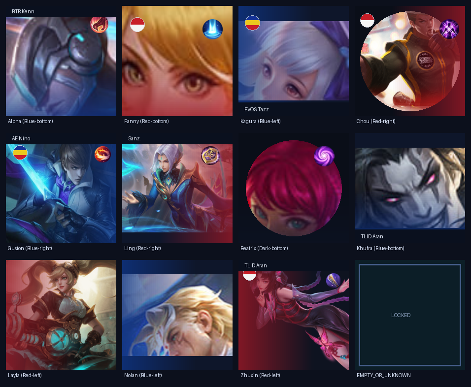

# MLBB Hero Vision

**100% Offline, Free, Zero-API Mobile Legends: Bang Bang (MLBB) Hero Recognition from Tournament Draft-Pick, Ban, and HUD Crops.**

- **Hugging Face Model Hub:** [sansaks/mlbb-hero-vision](https://huggingface.co/sansaks/mlbb-hero-vision)
- **Model Weights & Release:** [GitHub Releases `v1.0.0`](https://github.com/sansaks-jpg/mlbb-hero-vision/releases/tag/v1.0.0) & Hugging Face Hub (auto-downloaded on first run)
- **License:** MIT

`mlbb-hero-vision` runs a **ConvNeXt-Tiny ONNX** student model (`114.16 MB`) distilled from Google **`gemini-embedding-2`** (`768-dim` semantic vectors) and trained on heavily augmented tournament overlays. It recognizes **135 MLBB heroes + `EMPTY_OR_UNKNOWN`** in **~48–66 ms on a standard laptop CPU** without internet access or API keys.

---

## Why Standard Classifiers Fail on Tournament Overlays

Plain pixel matchers or naive CNNs trained on clean wiki portraits break during real broadcasts because tournament HUD boxes have:
- **Occlusions:** Battle spell icons (Retribution, Flicker, Execute, etc.), country flags, and player IGN banners covering the corners or top/bottom bars.
- **Extreme crops & aspect ratios:** Wide banners, narrow strips, upper-face zooms, or circular ban frames.
- **Team color gradients:** Heavy dark, blue-team, or red-team edge gradients layered over the hero art.
- **Compression & skin variations:** Stream JPEG/bitrate blur and non-default hero skins.

To solve this without manual tournament screenshot labeling, we combine **Knowledge Distillation** from a foundation vision embedding teacher (`gemini-embedding-2`) with **Realistic Tournament Overlay Simulation**:



---

## Architecture & How It Works

```text
  [1,725 Multi-Shape Hero Assets + Skins]
                   │
                   ├──► Teacher: gemini-embedding-2 (768-d L2-normalized vectors)
                   │
                   └──► Tournament Overlay Simulator (on-the-fly per epoch)
                           ├─ Aspect/face/circle crops + horizontal flip
                           ├─ Team gradients (Blue / Red / Dark edge fade)
                           ├─ Real battle spell PNGs + circular flags + IGN bars
                           ├─ Brightness/contrast, Gaussian blur, JPEG artifacts
                           └─ 5% synthetic empty/locked slots (EMPTY_OR_UNKNOWN)
                                     │
                                     ▼
        [Student: ConvNeXt-Tiny (convnext_tiny.fb_in22k_ft_in1k)]
                   │
                   ├──► Linear(768 -> 768) + LayerNorm + L2-Norm Embedding
                   │        └── Distillation Loss: 2.0 * (1 - cos(student, teacher))
                   │
                   └──► Cosine Prototype Logits (scale = 18.0, 136 classes)
                            └── Classification Loss: CrossEntropy(label_smoothing=0.08)
                                     │
                                     ▼
               [ONNX Opset-17 Export + 1,725-Vector Retrieval Index]
                     Runs 100% offline via CPU ONNX Runtime (~50 ms)
```

Dual outputs at inference + **Out-of-Distribution (OOD) Rejection Gate**:
1. **`logits` -> `top_probabilities` (`136` classes):** Calibrated class probability across 135 heroes + `EMPTY_OR_UNKNOWN`.
2. **`embedding` (`768-d`) -> `top_candidates` (`1,725` assets):** Nearest-neighbor asset match showing exact hero shape/skin source metadata.
3. **5-Signal OOD Rejection Gate:** Automatically rejects non-MLBB images (human faces, UI screenshots, battle spells alone, blurry noise) returning `"hero": null`, `"is_mlbb_hero": false`, and `"rejection_reason"` whenever `confidence < 0.52`, `prob_margin < 0.30`, `proto_cos < 0.27`, `db_top1 < 0.885`, or `entropy > 2.75`.

---

## Training Metrics & Benchmarks

### Kaggle Tesla T4 Training Run (`18 Epochs`, `9,600` simulated overlays/epoch)
Trained on Kaggle GPU (`Tesla T4`, PyTorch `2.11.0+cu130`, `AdamW lr=2.5e-4`, `CosineAnnealingLR`, batch size `64`):

| Epoch | Total Loss | Classification Loss (`cls`) | Distillation Loss (`dist`) | Train Accuracy |
| :--- | :---: | :---: | :---: | :---: |
| `01 / 18` | `2.3082` | `1.6238` | `0.3422` | `83.46%` |
| `02 / 18` | `1.0754` | `0.7282` | `0.1736` | `99.75%` |
| `06 / 18` | `0.8102` | `0.6928` | `0.0587` | `99.71%` |
| `12 / 18` | `0.7451` | `0.6837` | `0.0307` | `99.94%` |
| `15 / 18` | `0.7374` | `0.6821` | `0.0277` | `99.96%` |
| `18 / 18` | `0.7351` | `0.6823` | `0.0264` | **`99.93%`** |

Total Kaggle training + export runtime: **917.5s (~15.3 min)**.

> **Checkpoint note (`v1.0.0`):** The released `v1.0.0` ONNX weights were trained on Kaggle (`v2` run) using dark edge gradients + full spell/IGN/flag/crop/JPEG tournament augmentations, and already scored **60/60 (100.0%)** on both Blue Team and Red Team gradient stress tests below. [`train/train_distill.py`](train/train_distill.py) additionally randomizes explicit Blue, Red, and Neutral Dark team edge gradients (`left` / `right` / `bottom`) when retraining.

### Inference Benchmarks (`CPUExecutionProvider` on AMD Ryzen 5 6600H)

| Evaluation Suite | Samples | Top-1 Accuracy | Top-5 Accuracy | Avg CPU Latency |
| :--- | :---: | :---: | :---: | :---: |
| Kaggle Hard Tournament Stress Test | `200` | **`100.0%`** | **`100.0%`** | — |
| Blue Team Gradient + Spell + IGN + Flag | `60` | **`100.0%` (`60/60`)** | **`100.0%` (`60/60`)** | `49.2 ms/crop` |
| Red Team Gradient + Spell + IGN + Flag | `60` | **`100.0%` (`60/60`)** | **`100.0%` (`60/60`)** | `48.6 ms/crop` |
| Real Broadcast Cropped Frame (`Alpha` + Retribution) | `1` | **`Alpha` (`89.68%` conf)** | `#2 Saber 0.55%` | `52.6–65.8 ms` |
| Empty / Locked Slot Probe | `1` | **`EMPTY_OR_UNKNOWN` (`92.13%`)** | — | `~50 ms` |

---

## Quick Start

### 1. Install
```bash
git clone https://github.com/sansaks-jpg/mlbb-hero-vision.git
cd mlbb-hero-vision
pip install -r requirements.txt
```
Or install directly via pip (adds `mlbb-hero-predict` command & caches weights cleanly in `~/.cache/mlbb-hero-vision`):
```bash
pip install git+https://github.com/sansaks-jpg/mlbb-hero-vision.git
mlbb-hero-predict --image hero_slot.png
```

### 2. Python API
On first run, `HeroVision()` automatically downloads the 4 model files (`hero_student.onnx`, `hero_student_db.npz`, `hero_student_labels.json`, `hero_student_meta.json`) into `./models/` from Hugging Face (with GitHub Release fallback):

```python
from mlbb_hero_vision import HeroVision

vision = HeroVision()  # auto-downloads weights on first call, 100% offline afterwards
result = vision.predict("path/to/cropped_hero_slot.png")

print(result["hero"])        # e.g. "Alpha" (or None if EMPTY_OR_UNKNOWN)
print(result["confidence"])  # e.g. 0.8968
print(result["latency_ms"])  # e.g. 52.6
print(result["top_probabilities"][:3])
```

### 3. CLI Usage
```bash
# Pre-download model files only
python predict.py --download-only

# Predict a single hero crop
python predict.py --image hero_slot.png --top-k 5

# Batch predict all images in a folder
python predict.py --folder ./cropped_slots/
```

### 4. Interactive Offline Web UI
Upload any full draft-pick screenshot, drag-select a hero box with your mouse, and inspect Top-5 offline predictions:
```bash
python -m mlbb_hero_vision.server
# Open http://127.0.0.1:8787
```

---

## Model Artifacts

| File | Size | Purpose |
| :--- | :---: | :--- |
| `hero_student.onnx` | `114.16 MB` | Quantization-free FP32 ConvNeXt-Tiny ONNX model (`pixel_values` `[B,3,224,224]` -> `embedding` `[B,768]`, `logits` `[B,136]`) |
| `hero_student_db.npz` | `2.41 MB` | Normalized `float16` `[1725, 768]` student retrieval index |
| `hero_student_labels.json` | `1.65 KB` | Ordered list of `136` output class names (`135` heroes + `EMPTY_OR_UNKNOWN`) |
| `hero_student_meta.json` | `197.86 KB` | Per-vector hero/shape/source metadata matching `hero_student_db.npz` |

---

## Retraining / Adding New Heroes

You can retrain or extend the model with new hero releases or custom tournament overlays using [`train/train_distill.py`](train/train_distill.py) or the included Google Colab notebook [`train/mlbb_hero_distill_colab.ipynb`](train/mlbb_hero_distill_colab.ipynb):

```bash
pip install timm onnx onnxscript onnxruntime
python train/train_distill.py \
  --data-dir /path/to/hero-assets \
  --out-dir ./models \
  --epochs 18 \
  --batch-size 64
```

- If `_distill/gemini_embedding_index.npz` + `gemini_embedding_meta.json` exist inside `--data-dir`, cosine distillation loss is applied automatically alongside cross-entropy classification.
- If omitted, the trainer runs cleanly in supervised-only mode with the exact same tournament overlay simulator (including Red/Blue team edge gradients, spell overlays, IGN bars, flags, and circular crops).

---

## Disclaimer & License

- Code, training scripts, and trained model weights are released under the **MIT License**.
- *Mobile Legends: Bang Bang* hero names and visual likenesses belong to MOONTON Games. No copyrighted raw game art is redistributed in this repository—only model weights, synthetic preview composites, and inference/training code.
